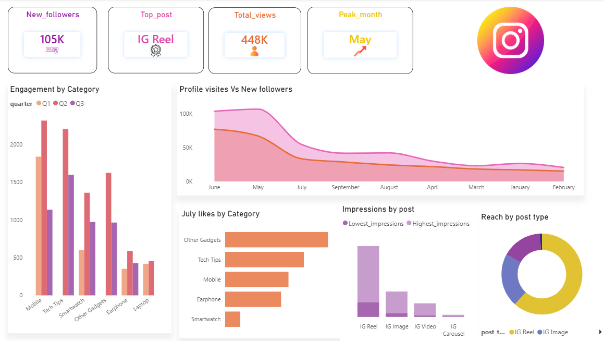

# Instagram_Analysis
# 📸 Instagram Analytics — SQL Challenge

> A deep-dive SQL analysis of Instagram content performance, audience growth, and engagement patterns for a virtual internship challenge.

---

## 📌 Project Overview

This project analyses an Instagram creator's performance data using MySQL. The goal is to surface actionable insights on post reach, audience engagement, follower growth, and content strategy using structured SQL queries across a star-schema database.

**Tools Used:** MySQL · SQL Window Functions · CTEs · Aggregate Functions  


---

## 🗄️ Database Schema

```
fact_content          fact_account          dim_dates
─────────────         ─────────────         ─────────────
date                  date                  date
post_type             new_followers         week_no
post_category         profile_visits        month_name
impressions                                 day_of_week
reach
likes
comments
saves
shares
```

### Analytical Dashboard



---
# Wavecon Telecom: 5G Launch Impact Analysis

A business intelligence analysis of how Wavecon Telecom's 5G launch affected revenue, customers, plans, and market position (Jan to Sep 2022). Completed as part of the Codebasics Virtual Internship with AtliQ Technologies.

## Presentation
[View the full presentation](Wavecon_5G_Analysis.pptx)

## Business Questions
1. What was the revenue impact of the 5G launch?
2. Which KPIs underperformed after launch?
3. Which plans did well, and which did not?
4. Should any plans be discontinued, and why?
5. Were any plans discontinued after 5G, and what drove that?

## Key Findings

| Metric | Before 5G | After 5G | Change |
|---|---|---|---|
| Revenue | ₹1,506 Cr | ₹1,265 Cr | -16.0% |
| ARPU (avg revenue per user) | ₹190.2 | ₹211.5 | +11.2% |
| Active users | 7.98M | 7.71M | -3.4% |
| Unsubscribed users | 1.01M | 1.22M | +20.8% |

- **Revenue:** Fell after launch, with a steady month-on-month decline in Q3 2022.
- **Customers:** Each customer paid more, but more customers left.
- **Plans:**
  - Growing: Smart Recharge, Ultra 5G, Data Booster
  - Declining: Basic Talk, 1-Day Prepaid
  - Discontinued: Legacy 3G Pack (obsolete technology, near-zero users, under 0.5% of revenue)
- **Market share:** Wavecon (Atliqo) dropped 2 points to 23%, while Dadafone gained 3 points to lead at 28%.
- **Cities:** Delhi (-20.0%) and Mumbai (-18.6%) had the steepest declines. Hyderabad (-3.6%) and Ahmedabad (-3.8%) held up best.


### Presentation of visual - [PPT](https://drive.google.com/file/d/1hapKuomxEWje0ejJIlr3b0txeMVgIuNr/view?usp=drive_link)
## 🔍 Queries & Business Questions

### 1. Explore Post Types & Impression Range
```sql
SELECT DISTINCT post_type FROM gdb0120.fact_content;

SELECT
    MIN(impressions) AS min_impressions,
    MAX(impressions) AS max_impressions
FROM fact_content;
```
**Purpose:** Understand the variety of content types available and the spread of impressions across all posts.

---

### 2. Post Categories by Month
```sql
SELECT
    MONTHNAME(date)                                             AS month_name,
    GROUP_CONCAT(DISTINCT post_category ORDER BY post_category
                 SEPARATOR ', ')                               AS post_category_names,
    COUNT(DISTINCT post_category)                              AS post_category_count
FROM fact_content
GROUP BY MONTH(date), MONTHNAME(date)
ORDER BY MONTH(date);
```
**Purpose:** Track which content categories were active each month to identify seasonal content diversity trends.

---

### 3. Reach Share by Post Type *(Window Function)*
```sql
SELECT
    post_type,
    SUM(reach)                                              AS total_reach,
    ROUND(
        (SUM(reach) * 100.0) / SUM(SUM(reach)) OVER (),
        2
    )                                                       AS reach_percentage
FROM fact_content
GROUP BY post_type
ORDER BY reach_percentage DESC;
```
**Purpose:** Identify which post formats (Reels, Carousel, Photo, etc.) drive the highest share of total audience reach.  
**Technique:** `SUM() OVER()` window function for running percentage without a subquery.

---

### 4. Comments & Saves by Category per Quarter *(CASE WHEN)*
```sql
SELECT
    post_category,
    CASE
        WHEN EXTRACT(MONTH FROM date) IN (1,2,3) THEN 'Q1'
        WHEN EXTRACT(MONTH FROM date) IN (4,5,6) THEN 'Q2'
        WHEN EXTRACT(MONTH FROM date) IN (7,8,9) THEN 'Q3'
    END                  AS quarter,
    SUM(comments)        AS total_comments,
    SUM(saves)           AS total_saves
FROM fact_content
WHERE EXTRACT(MONTH FROM date) BETWEEN 1 AND 9
GROUP BY post_category, quarter
ORDER BY post_category, quarter;
```
**Purpose:** Understand how engagement (comments + saves) evolves quarterly for each content category.

---

### 5. Top 3 Follower-Growth Days per Month *(CTE + ROW_NUMBER)*
```sql
WITH ranked_data AS (
    SELECT
        MONTHNAME(date)  AS month,
        date,
        new_followers,
        ROW_NUMBER() OVER (
            PARTITION BY MONTH(date)
            ORDER BY new_followers DESC
        )                AS rnk
    FROM fact_account
)
SELECT month, date, new_followers
FROM ranked_data
WHERE rnk <= 3
ORDER BY month, new_followers DESC;
```
**Purpose:** Find the top 3 days of highest follower acquisition within each calendar month to identify viral content dates.  
**Technique:** `ROW_NUMBER()` with `PARTITION BY` for per-group ranking.

---

### 6. Shares by Post Type in Week 12 *(LEFT JOIN)*
```sql
SELECT
    f.post_type,
    SUM(f.shares) AS total_shares
FROM fact_content f
LEFT JOIN dim_dates d ON f.date = d.date
WHERE d.week_no = 12
GROUP BY f.post_type
ORDER BY total_shares DESC;
```
**Purpose:** Analyse share activity during a specific week to understand virality by content format.

---

### 7. Weekend Content Performance *(DAYOFWEEK + CASE WHEN)*
```sql
SELECT
    *,
    CASE
        WHEN DAYOFWEEK(date) IN (1,7) THEN 'Weekend'
        ELSE 'Weekday'
    END AS day_type
FROM fact_content
WHERE MONTH(date) IN (3,4)
  AND DAYOFWEEK(date) IN (1,7);
```
**Purpose:** Isolate all weekend posts in March and April to compare engagement against weekday performance.

---

### 8. Monthly Profile Visits & New Followers *(JOIN + Aggregation)*
```sql
SELECT
    MONTHNAME(d.date)       AS month_name,
    SUM(f.profile_visits)   AS total_profile_visits,
    SUM(f.new_followers)    AS total_new_followers
FROM fact_account f
JOIN dim_dates d ON f.date = d.date
GROUP BY MONTHNAME(d.date)
ORDER BY MIN(d.date);
```
**Purpose:** Track the monthly funnel from profile discovery (visits) to conversion (new followers).

---

### 9. Top Liked Categories in July *(CTE)*
```sql
WITH likes_cte AS (
    SELECT
        f.post_category,
        SUM(f.likes) AS total_likes
    FROM fact_content f
    JOIN dim_dates d ON f.date = d.date
    WHERE d.month_name = 'July'
    GROUP BY f.post_category
)
SELECT post_category, total_likes
FROM likes_cte
ORDER BY total_likes DESC;
```
**Purpose:** Rank content categories by total likes in July to inform content prioritisation for peak-summer strategy.

---

